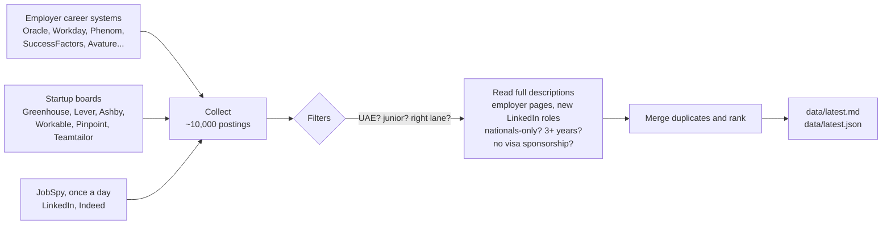

# 🏙️ uae-job-engine

**A tiny robot that job-hunts in the UAE while you sleep.**

Twice a day, a free GitHub Actions run visits about 100 employer career sites and job boards, collects every opening it can find, throws away everything that isn't a junior role in data, BI, AI/ML, software or IT, and writes a tidy list of what's left. No servers, no accounts, no logins, no cost.

On a typical day it reads **~10,000 postings** and keeps **~120 roles** worth looking at.

> Built for one person's job search, shared so you can fork it for yours: another city, another country, another career. 🍴

---

## 🤔 Why this exists

Job boards only show part of the market. Many big employers (banks, telcos, airports, government-linked companies) post openings on their own career systems: Oracle, Workday, SuccessFactors, Phenom and friends. Search engines index those pages poorly, and the roles often never reach LinkedIn.

Every one of those career sites is backed by a public listing (JSON, RSS or plain HTML) that the site's own job search uses. This project reads those listings directly, politely, and puts everything in one place.

## 📬 What you get

Everything lands in [`data/`](data), refreshed after every run:

| File | What it is |
|---|---|
| [`latest.md`](data/latest.md) | 📋 A status panel, then a readable table of every matching role, newest first. Start here. |
| [`latest.json`](data/latest.json) | 🤖 The same list, machine-readable (handy for a digest email or a chatbot) |
| [`health.json`](data/health.json) | 🩺 Which sources worked this run, how many jobs each returned, which were blocked, and what each job-site search query brought (`by_query`) |
| `direct_links.json` | 🧭 The employers' own job systems behind the roles the job sites showed, counted over 30 days: the next employers worth collecting directly |
| `streaks.json` | 📈 Failed runs in a row per source, so a source that keeps failing stands out from a one-off |
| [`rejected_sample.json`](data/rejected_sample.json) | 🗑️ Up to 60 dropped UAE roles per reason, for tuning the filters. A role dropped for its description carries the sentence that decided it (`why`) |
| `history/<date>.json` | 📅 Roles first seen on that day |
| `seen.json`, `detail_cache.json` | 🧠 Memory between runs: what's been seen, and what each job page said |

`latest.md` opens with a status panel:

> **Sources:** 102 of 103 answered · **Blocked:** jobspy:linkedin, 1 of 8 queries blocked · **LinkedIn pages:** 15 of 15 new roles read; 2 dropped after reading (2 3+ years) · **New roles in the last 7 days:** 187 from Indeed and LinkedIn; 20 from employer sites and boards

and then the list. A few rows:

| # | New | Role | Employer | City | Lane | Posted | Found on | Notes |
|---|---|---|---|---|---|---|---|---|
| 1 | 🆕 | Marketing & Business Insights Junior Analyst | Medtronic | Dubai | BI / reporting | 2026-11-12 | workday + linkedin | entry level |
| 2 | 🆕 | Junior Full Stack Developer [L1] | Alef Education | Abu Dhabi | Software / backend | 2026-11-12 | indeed | asks 1 yr; [employer site](https://example.com) |
| 3 | | Data Analyst – Databricks AI/BI & FinOps | Etihad | Abu Dhabi | Data analyst | | linkedin + indeed | |

Each record in `latest.json` carries: `key, title, employer, sector, city, location, family, cv, seniority, url, source, source_type, posted, age_days, min_years, flags, first_seen, last_seen, is_new, score, snippet`. These field names are kept stable on purpose, so anything reading the file keeps working. Newer fields are added beside them: `seen_on` (every site the job was found on) and `apply_url` (the employer's own posting, when a job site named it). `summary.status` holds the status panel's numbers.

The **Notes** column says what the posting itself gave away: how many years it asks for, `entry level` when it welcomes newcomers, `LinkedIn says mid-senior`, `UAE nationals preferred`, `agency or unnamed employer`, and a link to the employer's own posting when Indeed named one.

## ⚙️ How it works



**One job, one row.** The same opening often appears on several sites, with the employer spelled differently ("Etihad" / "Etihad Airways", "Amazon" / "Amazon.com"), the title reworded ("Databricks Data Analyst" / "Data Analyst – Databricks"), a different city, or an agency's fresh reference code. Jobs are matched on fingerprints of the employer and the title that ignore all of that, so each job shows once, with every site it was found on, and a repost isn't announced as new.

| When (Dubai time) | What runs |
|---|---|
| Around 05:00 (first wake-up after 00:30) | ☀️ Career systems only |
| Around 12:30 (first wake-up after 12:00) | 🌤️ Full run: every career system, the job sites through JobSpy, and every 6 days a probe that looks for new startup boards |
| On every code push | 🔧 Career systems only, so testing a change never doubles the LinkedIn and Indeed queries |

**Why "around" and "first wake-up after"?** GitHub starts scheduled runs late: 4.5 to 8 hours after the cron time for this repository in November 2026, once more than 10. A cron line can't say when a run happens. Waking every half hour doesn't help either: GitHub keeps only one waiting start per cron line, and a half-hourly line was started once in 11 hours. So the workflow has five cron lines a day, placed where their starts have landed so far, and a tiny script ([`engine/when.py`](engine/when.py)) decides from the clock what a wake-up does: the first one after `SYSTEMS_AFTER` reads the career systems, the first one after `FULL_AFTER` does the full run, and the spare ones exit within seconds without touching any site. Both values sit at the top of [`.github/workflows/collect.yml`](.github/workflows/collect.yml), in Dubai time. The job sites are never searched twice within 12 hours, and a full run that was missed altogether is made up at the next wake-up.

**Why midday?** Postings appear during the working day: in a sample of 443 UAE postings on Indeed (November 2026), 6% were posted before 05:00, 28% before 12:00, 54% before 15:00 and 82% before 18:00. A search before dawn finds yesterday's jobs. A midday run still finishes before an early-afternoon digest; if you read your list in the evening, a run around 17:00 catches four fifths of the day's postings the same day (move the cron lines about seven hours ahead of the time you want, then watch where the starts land).

**Saturdays:** Workday does its weekly maintenance on Saturday morning UTC, right when the full run starts, so its employers show as failing in that run. Their roles are carried over and read again by the next run.

A full run takes up to a quarter of an hour (most of it the slow LinkedIn page reading); a career-systems-only run about a minute.

## 🕵️ Where it looks

| System | Employers |
|---|---|
| **Oracle Recruiting Cloud** | ADIB, Emirates NBD, Emirates Islamic, FAB, Mashreq, du, e&, Emaar, DP World, Dubai Airports, AD Ports, NMC, PureHealth, SEHA, SSMC, Aster, KPMG Lower Gulf, Dell, Oracle |
| **Workday** | Mastercard, Salesforce, HP, Shell, Baker Hughes, KBR, GSK, AstraZeneca, Novartis, Pfizer, Philips, Coca-Cola, Thomson Reuters, Rolls-Royce, Cleveland Clinic Abu Dhabi, Medtronic, Accenture, DXC Technology, Cigna, GE Vernova, GE HealthCare, NVIDIA, Snap |
| **Phenom** | ADCB, G42, Majid Al Futtaim, ADNOC |
| **SAP SuccessFactors** | EY, PwC Middle East, Al-Futtaim |
| **Avature** | Dubai Holding |
| **Jibe (iCIMS)** | M42, Schneider Electric |
| **Attrax** | talabat |
| **Own feeds** | Emirates Group (Emirates, dnata), Amazon (UAE only), Deriv |
| **Startup boards** | Careem, Tamara, Tabby, Chalhoub, Property Finder, Ziina, Checkout.com, qlub, dubizzle, Aldar, Yassir, Kraken, Fuse Energy, Brain Co., Easygenerator, Esri, Deliveroo, Bybit, OKX, Cohere, OpenAI, ElevenLabs and more |
| **JobSpy** (no login) | LinkedIn and Indeed: 22 searches a day in total, plus up to 20 LinkedIn job pages. Bayt is switched off: it refused every query |

Some big names aren't covered, and [`config/employers.yaml`](config/employers.yaml) says why for each one. Usually it's because their robots.txt says no, their jobs sit behind a login, or they only post on LinkedIn. Those still show up through the JobSpy searches.

**Why most new roles still come from LinkedIn and Indeed.** Junior roles are a long tail: in twelve days of November 2026, the kept roles from the job sites came from 252 different employers, and 209 of those appeared exactly once. No list of employers can cover that. What a list can do is follow the market: when an employer keeps showing up on the job sites, find its own job system and read it directly, for a direct link, the full description and no dependence on a site that may refuse the next search. Two files help: `data/direct_links.json` (where Indeed's "apply on company site" links lead) and `by_query` in `data/health.json` (which searches earn their place).

## 🧹 The filters

Out of ~10,000 postings, a role survives only if:

- ✅ **It's in the UAE.** That includes titles like "Data Analyst – Riyadh, KSA" whose listing claims Dubai: those are caught and dropped.
- ✅ **It's in a target lane:** data analysis, BI, data science, AI/ML, data engineering, product, business analysis, software/backend, IT, or a graduate programme. Internships are out: employers in the UAE don't sponsor a work visa for them, while some graduate and trainee programmes do.
- ✅ **It isn't senior.** Director, head, VP and principal titles are always out. Senior, lead and manager titles are out unless the title also says junior, graduate, trainee or similar ("Senior Associate" counts as senior). A second level counts as senior too: "Data Analyst II", "Engineer 2", "[L2]", "Tier 2". The first level stays ("Engineer I", "L1").
- ✅ **It isn't a lookalike.** Sales, account executives, audit, tax, nursing, design, frontend/mobile and similar roles are dropped, and so are talent pools, career fairs and open applications. Finance and compliance titles survive only if they're clearly technical ("AML Data Analyst" stays).
- ✅ **It's still open.** Job-site postings (LinkedIn, Indeed) older than 21 days are dropped; employer and board postings older than 120 days too (those are evergreen ads, not openings). Anything older than 30 days ranks lower.
- ✅ **The full description passes:**
  - Roles open only to UAE nationals are dropped. "Nationals preferred" roles are kept, flagged and ranked lower.
  - Roles asking for 3 or more years of experience are dropped (`MAX_YEARS` in [`run.py`](run.py)); roles asking for up to 2, or naming no number, stay. The number is the first requirement the posting states: in "6-8 years of experience, including at least 2 years in ..." it is 6, not 2. "Up to 7 years" is a ceiling, not a requirement, and doesn't count.
  - Roles that say they won't sponsor a visa are dropped.
- 🌱 **Junior signals.** Three roles in four name no years of experience, so the list marks the ones that say a newcomer is welcome: the posting asks for a year at most, its words say so ("fresh graduates are welcome", "no prior experience required", "entry-level"; not "freshers please excuse"), or LinkedIn's own level label on the job page says "Entry level". Those get an `entry_level` flag and rank higher. "Mid-Senior level" on LinkedIn ranks a role lower (`mid_senior`) unless its title says junior, and "Internship", "Director" or "Executive" there drops it.
- 🏷️ **Agencies are marked, not dropped.** A posting by a recruitment agency or an unnamed ("Confidential") employer gets an `agency` flag, shows "agency or unnamed employer" in Notes, and ranks a little lower: expect a screening call first, and often a wish for candidates already in the country. The list of agency names is `AGENCY_RE` in [`engine/util.py`](engine/util.py).
- 🔗 **LinkedIn roles get the same checks.** LinkedIn's search results come without a description, so the full run opens the public page of each LinkedIn role that's new that day: up to 20 a day, best fit first, one page at a time, 20 to 40 seconds apart. A page is read once; what it said is remembered. Jobs that another site already describes are skipped, so are titles that already say UAE nationals, and a copy of a job that came without any description takes the verdict of a copy that had one, so a nationals-only role can't sneak back in through the site that left the words out.

Every rule is pinned by a real title in [`tests/test_filters.py`](tests/test_filters.py) (100+ cases), so tuning one rule can't quietly break another.

## 🍴 Make it yours

Want this for Riyadh, London, or for marketing roles instead of data? Here's the recipe.

1. **Fork this repo.**
2. **Make it yours, not mine.** In [`engine/http.py`](engine/http.py), change `USER_AGENT` to point at *your* fork, so site owners can see who's visiting. Delete the files in `data/` to start with a clean history.
3. **Pick your employers** in [`config/employers.yaml`](config/employers.yaml). Remove the ones you don't care about and add your own (see the detective guide below).
4. **Pick your searches** in [`config/search.yaml`](config/search.yaml). Keep the daily total low (about 30). `linkedin_pages` caps the LinkedIn pages read a day; 0 switches the reading off.
5. **Teach it your lanes** in [`engine/util.py`](engine/util.py):
   - `UAE_RE` and `CITY_RE`: where you want to work
   - `FAMILIES`: which job titles you want
   - `EXCLUDE_RE`, `SENIOR_HARD_RE` and friends: what to throw away
   - The nationals-only rules are UAE-specific (Emiratisation); swap them for your country's equivalent, or remove them

   Then update [`tests/test_filters.py`](tests/test_filters.py) with titles you've actually seen, and run the tests.
6. **Turn on Actions** in your fork (the Actions tab; forks start with scheduled workflows off). In [`.github/workflows/collect.yml`](.github/workflows/collect.yml), `FULL_AFTER` and `SYSTEMS_AFTER` say after what time each run may happen, and the cron lines say when GitHub is asked to wake the workflow: watch for a few days when your fork's runs really start, then move the lines. The times are Dubai time (UTC+4); change `DUBAI` in [`engine/when.py`](engine/when.py) and [`engine/util.py`](engine/util.py) for another timezone.
7. **Wait for the first run**, then open `data/latest.md` and `data/health.json`. If the commit step fails with a permission error, check *Settings → Actions → General → Workflow permissions*.

## 🔎 Adding an employer: a little detective work

Open the employer's careers page, click through to a job, and look at the address bar or the page source. The job system usually gives itself away:

| If you see... | It's... | Add it under |
|---|---|---|
| `….oraclecloud.com/hcmUI/CandidateExperience/en/sites/CX_1` | Oracle Recruiting Cloud | `oracle:` with `host` and `sites` |
| `….wd3.myworkdayjobs.com/SiteName` | Workday | `workday:` with `tenant`, `wd`, `site` |
| `phApp.ddo` in the page, URLs like `/global/en/job/123` | Phenom | `phenom:` with `base` |
| `/search/?q=&locationsearch=`, `/job/City-Title/123/` | SAP SuccessFactors | `successfactors:` with `base` |
| `….avature.net/…/JobDetail/…` | Avature | `avature:` |
| `boards.greenhouse.io`, `jobs.lever.co`, `jobs.ashbyhq.com`, `apply.workable.com`, `….pinpointhq.com`, `….teamtailor.com` | Startup boards | `boards:` with `ats` and `token` |
| `….jibeapply.com`, a page that loads `/api/jobs` | Jibe (iCIMS) | `jibe:` with `base`, and `country` for a worldwide site |

Not sure where to start? `data/direct_links.json` lists the job systems that Indeed's apply links point to, most frequent first: the host usually names both the system and the employer (`medtronic.wd1.myworkdayjobs.com`).

**⚠️ The Oracle trap.** Oracle sites have numbers (`CX_1`, `CX_1001`, ...). If you guess one that's wrong or inactive, Oracle doesn't complain: it quietly returns *another* site's jobs. So the collector refuses to guess. List the real ones with

```
https://{host}/hcmRestApi/resources/latest/recruitingCESites?onlyData=true
```

pick one whose `StatusCode` is `ORA_ACTIVE`, and check it matches the link on the employer's careers page. An entry with no `sites` fails on purpose and lists the active ones for you.

Before adding a new kind of system, check its `robots.txt`. If it says no, it's a no. 🙅

## 💻 Run it on your own machine

```bash
pip install -r requirements.txt
FULL_RUN=0 python run.py   # career systems only, about a minute
python run.py              # everything, including JobSpy
python -m tests.test_filters
python -m tests.test_when          # which wake-up does the full run
python -m tests.test_offline_run   # the whole pipeline against fake responses, no network
```

Local runs write to `data/`. Don't commit that: let the Actions run own `data/` (`git checkout -- data` before committing code).

## 🤝 Good manners

This project reads public listings that the sites' own job searches use, and it tries hard to be a polite guest:

- 🐢 **One request at a time per site**, at least a second apart, longer where a site's robots.txt asks for it
- 🏷️ **An honest User-Agent** that says what it is and links back here
- 🤖 **robots.txt is respected.** Sites that say no (some do) are listed as not collected, never worked around.
- 🔐 **No accounts, logins, cookies or proxies.** Ever.
- 📉 **Low volume:** two runs a day, 22 JobSpy searches a day in total, and at most 20 LinkedIn job pages, 20 to 40 seconds apart. The spare wake-ups contact no site at all.
- 🚫 **When a site blocks it,** that's recorded in `health.json`, and nothing tries to get around it. After two blocked searches in a row, the site is left alone for the rest of the run. The first refused LinkedIn page ends the page reading for the day, and no pages are read at all if LinkedIn refused the searches.

LinkedIn and Indeed (and Bayt, when it is switched on) don't allow automated access in their terms. JobSpy usage here is deliberately tiny, and you can switch any site off by removing its list from `config/search.yaml` (and the LinkedIn page reading with `linkedin_pages: 0`). JobSpy sends its own browser-style headers, not the User-Agent above, for its searches and the LinkedIn pages alike.

## ❓ FAQ

**Does it apply to jobs for me?** No. It finds them; applying is still your job (and your cover letter's).

**Why doesn't it cover company X?** Check the "Checked ... and not collected" list in `config/employers.yaml`. If X isn't there, it probably just hasn't been looked at yet. Open an issue or a pull request!

**LinkedIn shows `blocked` in `health.json`. Is something broken?** No. LinkedIn sometimes refuses automated requests. The run records it and carries yesterday's LinkedIn roles over for up to three days, re-checked against the current filters, so a filter change reaches the list at once.

**Why are there runs that take 15 seconds?** Those are spare wake-ups: they check the clock, find the day's run already done and exit. GitHub starts scheduled runs hours late and not at a steady delay, so the workflow keeps a few spare starts a day. See "How it works".

**Can I get the list by email or in a chat app?** Point anything at `data/latest.json`. A small scheduled script or a chatbot can read it and send you a daily digest of roles where `is_new` is true.

**Is my data in here?** There's nothing personal in this repo: no CVs, emails or phone numbers. Please keep it that way in your fork, because it's public.

## 🙌 Contributing

Found a great junior role that got filtered out, or a senior one that slipped through? That's the most useful thing you can report. Open an issue with the title and the reason. Even better, add it to `tests/test_filters.py` and fix the rule in a pull request.

New employers, new job systems and better filters are all welcome. Please keep the good-manners rules above.

## 📜 License and disclaimer

The code is [MIT licensed](LICENSE): use it, fork it, change it, share it.

Not affiliated with any employer or job site listed here. Job data belongs to the employers who posted it; this tool only links back to their own pages. Listings change constantly, so always check the original posting before applying.
