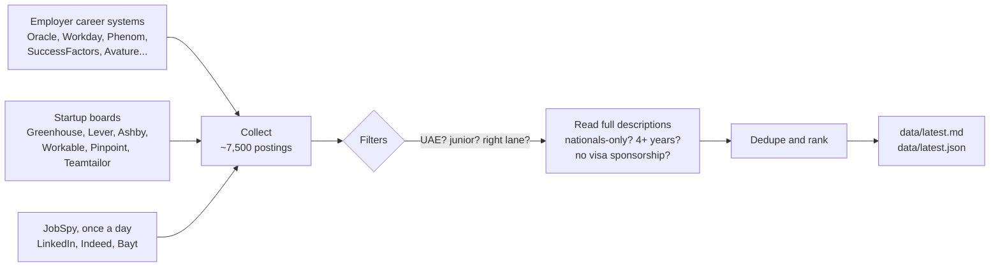

# 🏙️ uae-job-engine

**A tiny robot that job-hunts in the UAE while you sleep.**

Twice a day, a free GitHub Actions run visits about 80 employer career sites and job boards, collects every opening it can find, throws away everything that isn't a junior role in data, BI, AI/ML, software or IT, and writes a tidy list of what's left. No servers, no accounts, no logins, no cost.

On a typical day it reads **~7,500 postings** and keeps **~100 roles** worth looking at.

> Built for one person's job search, shared so you can fork it for yours: another city, another country, another career. 🍴

---

## 🤔 Why this exists

Job boards only show part of the market. Many big employers (banks, telcos, airports, government-linked companies) post openings on their own career systems: Oracle, Workday, SuccessFactors, Phenom and friends. Search engines index those pages poorly, and the roles often never reach LinkedIn.

Every one of those career sites is backed by a public listing (JSON, RSS or plain HTML) that the site's own job search uses. This project reads those listings directly, politely, and puts everything in one place.

## 📬 What you get

Everything lands in [`data/`](data), refreshed after every run:

| File | What it is |
|---|---|
| [`latest.md`](data/latest.md) | 📋 A readable table of every matching role, newest first. Start here. |
| [`latest.json`](data/latest.json) | 🤖 The same list, machine-readable (handy for a digest email or a chatbot) |
| [`health.json`](data/health.json) | 🩺 Which sources worked this run, how many jobs each returned, and which were blocked |
| [`rejected_sample.json`](data/rejected_sample.json) | 🗑️ Up to 60 dropped UAE roles per reason, for tuning the filters |
| `history/<date>.json` | 📅 Roles first seen on that day |
| `seen.json`, `detail_cache.json` | 🧠 Memory between runs: what's been seen, and what each job description said |

A row of `latest.md` looks like this:

| # | New | Role | Employer | City | Lane | Posted | Source | Notes |
|---|---|---|---|---|---|---|---|---|
| 1 | 🆕 | Data Analyst - Intern | dubizzle Group | Dubai | Data analyst | 2026-10-21 | workable | |
| 2 | 🆕 | Software Engineer II - Backend | talabat | Dubai | Software / backend | | attrax | |
| 3 | | Backend Engineer, Payments Platform | Ziina | Dubai | Software / backend | | ashby | asks 3 yrs |

Each record in `latest.json` carries: `key, title, employer, sector, city, location, family, cv, seniority, url, source, source_type, posted, age_days, min_years, flags, first_seen, last_seen, is_new, score, snippet`. These field names are kept stable on purpose, so anything reading the file keeps working.

## ⚙️ How it works



| When (Dubai time) | What runs |
|---|---|
| 05:13 | 🌅 Full run: every career system, JobSpy, and every 6 days a probe that looks for new startup boards |
| 12:43 | ☀️ Career systems only, so the list is fresh for the afternoon |
| On every code push | 🔧 Career systems only, so testing a change never doubles the LinkedIn/Indeed/Bayt queries |

A full run takes a few minutes; a career-systems-only run about a minute.

## 🕵️ Where it looks

| System | Employers |
|---|---|
| **Oracle Recruiting Cloud** | ADIB, Emirates NBD, Emirates Islamic, FAB, Mashreq, du, e&, Emaar, DP World, Dubai Airports, AD Ports, NMC, PureHealth, SEHA, SSMC, Aster, KPMG Lower Gulf, Dell, Oracle |
| **Workday** | Mastercard, Salesforce, HP, Shell, Baker Hughes, KBR, GSK, AstraZeneca, Novartis, Pfizer, Philips, Coca-Cola, Thomson Reuters, Rolls-Royce, Cleveland Clinic Abu Dhabi |
| **Phenom** | ADCB, G42, Majid Al Futtaim |
| **SAP SuccessFactors** | EY, PwC Middle East, Al-Futtaim |
| **Avature** | Dubai Holding |
| **Jibe (iCIMS)** | M42 |
| **Attrax** | talabat |
| **Own feeds** | Amazon (UAE only), Deriv |
| **Startup boards** | Careem, Tamara, Tabby, Chalhoub, Property Finder, Ziina, Checkout.com, qlub, dubizzle, Aldar, Yassir, Bybit, OKX, Cohere, OpenAI, ElevenLabs and more |
| **JobSpy** (no login) | LinkedIn, Indeed and Bayt: 28 searches a day in total |

Some big names aren't covered, and [`config/employers.yaml`](config/employers.yaml) says why for each one. Usually it's because their robots.txt says no, their jobs sit behind a login, or they only post on LinkedIn. Those still show up through the JobSpy searches.

## 🧹 The filters

Out of ~7,500 postings, a role survives only if:

- ✅ **It's in the UAE.** That includes titles like "Data Analyst – Riyadh, KSA" whose listing claims Dubai: those are caught and dropped.
- ✅ **It's in a target lane:** data analysis, BI, data science, AI/ML, data engineering, product, business analysis, software/backend, IT, or a graduate/intern programme.
- ✅ **It isn't senior.** Director, head, VP and principal titles are always out. Senior, lead and manager titles are out unless the title also says junior, associate, graduate or similar.
- ✅ **It isn't a lookalike.** Sales, account executives, audit, tax, nursing, design, frontend/mobile and similar roles are dropped. Finance and compliance titles survive only if they're clearly technical ("AML Data Analyst" stays).
- ✅ **The full description passes:**
  - Roles open only to UAE nationals are dropped. "Nationals preferred" roles are kept, flagged and ranked lower.
  - Roles asking for 4+ years of experience are dropped; 3 years is kept and flagged as a stretch.
  - Roles that say they won't sponsor a visa are dropped.

Every rule is pinned by a real title in [`tests/test_filters.py`](tests/test_filters.py) (100+ cases), so tuning one rule can't quietly break another.

## 🍴 Make it yours

Want this for Riyadh, London, or for marketing roles instead of data? Here's the recipe.

1. **Fork this repo.**
2. **Make it yours, not mine.** In [`engine/http.py`](engine/http.py), change `USER_AGENT` to point at *your* fork, so site owners can see who's visiting. Delete the files in `data/` to start with a clean history.
3. **Pick your employers** in [`config/employers.yaml`](config/employers.yaml). Remove the ones you don't care about and add your own (see the detective guide below).
4. **Pick your searches** in [`config/search.yaml`](config/search.yaml). Keep the daily total low (about 30).
5. **Teach it your lanes** in [`engine/util.py`](engine/util.py):
   - `UAE_RE` and `CITY_RE`: where you want to work
   - `FAMILIES`: which job titles you want
   - `EXCLUDE_RE`, `SENIOR_HARD_RE` and friends: what to throw away
   - The nationals-only rules are UAE-specific (Emiratisation); swap them for your country's equivalent, or remove them

   Then update [`tests/test_filters.py`](tests/test_filters.py) with titles you've actually seen, and run the tests.
6. **Turn on Actions** in your fork (the Actions tab; forks start with scheduled workflows off). The cron times in [`.github/workflows/collect.yml`](.github/workflows/collect.yml) are in UTC, so adjust them for your timezone.
7. **Wait for the first run**, then open `data/latest.md` and `data/health.json`. If the commit step fails with a permission error, check *Settings → Actions → General → Workflow permissions*.

## 🔎 Adding an employer: a little detective work

Open the employer's careers page, click through to a job, and look at the address bar or the page source. The job system usually gives itself away:

| If you see... | It's... | Add it under |
|---|---|---|
| `….oraclecloud.com/hcmUI/CandidateExperience/en/sites/CX_1` | Oracle Recruiting Cloud | `oracle:` with `host` and `sites` |
| `….wd3.myworkdayjobs.com/SiteName` | Workday | `workday:` with `tenant`, `wd`, `site` |
| `phApp.ddo` in the page, URLs like `/global/en/job/123` | Phenom | `phenom:` with `base` |
| `/search/?q=&locationsearch=`, `/job/City-Title/123/` | SAP SuccessFactors | `successfactors:` with `base` |
| `….avature.net/…/JobDetail/…` | Avature | `avature:` |
| `boards.greenhouse.io`, `jobs.lever.co`, `jobs.ashbyhq.com`, `apply.workable.com`, `….pinpointhq.com`, `….teamtailor.com` | Startup boards | `boards:` with `ats` and `token` |

**⚠️ The Oracle trap.** Oracle sites have numbers (`CX_1`, `CX_1001`, ...). If you guess one that's wrong or inactive, Oracle doesn't complain: it quietly returns *another* site's jobs. So the collector refuses to guess. List the real ones with

```
https://{host}/hcmRestApi/resources/latest/recruitingCESites?onlyData=true
```

pick one whose `StatusCode` is `ORA_ACTIVE`, and check it matches the link on the employer's careers page. An entry with no `sites` fails on purpose and lists the active ones for you.

Before adding a new kind of system, check its `robots.txt`. If it says no, it's a no. 🙅

## 💻 Run it on your own machine

```bash
pip install -r requirements.txt
FULL_RUN=0 python run.py   # career systems only, about a minute
python run.py              # everything, including JobSpy
python -m tests.test_filters
python -m tests.test_offline_run   # the whole pipeline against fake responses, no network
```

Local runs write to `data/`. Don't commit that: let the Actions run own `data/` (`git checkout -- data` before committing code).

## 🤝 Good manners

This project reads public listings that the sites' own job searches use, and it tries hard to be a polite guest:

- 🐢 **One request at a time per site**, at least a second apart, longer where a site's robots.txt asks for it
- 🏷️ **An honest User-Agent** that says what it is and links back here
- 🤖 **robots.txt is respected.** Sites that say no (some do) are listed as not collected, never worked around.
- 🔐 **No accounts, logins, cookies or proxies.** Ever.
- 📉 **Low volume:** two runs a day, and 28 JobSpy searches a day in total
- 🚫 **When a site blocks it,** that's recorded in `health.json`, and nothing tries to get around it

LinkedIn, Indeed and Bayt don't allow automated access in their terms. JobSpy usage here is deliberately tiny, and you can switch any site off by removing its list from `config/search.yaml`.

## ❓ FAQ

**Does it apply to jobs for me?** No. It finds them; applying is still your job (and your cover letter's).

**Why doesn't it cover company X?** Check the "Checked ... and not collected" list in `config/employers.yaml`. If X isn't there, it probably just hasn't been looked at yet. Open an issue or a pull request!

**LinkedIn shows `blocked` in `health.json`. Is something broken?** No. LinkedIn sometimes refuses automated requests. The run records it and carries yesterday's LinkedIn roles over for up to three days.

**Can I get the list by email or in a chat app?** Point anything at `data/latest.json`. A small scheduled script or a chatbot can read it and send you a daily digest of roles where `is_new` is true.

**Is my data in here?** There's nothing personal in this repo: no CVs, emails or phone numbers. Please keep it that way in your fork, because it's public.

## 🙌 Contributing

Found a great junior role that got filtered out, or a senior one that slipped through? That's the most useful thing you can report. Open an issue with the title and the reason. Even better, add it to `tests/test_filters.py` and fix the rule in a pull request.

New employers, new job systems and better filters are all welcome. Please keep the good-manners rules above.

## 📜 Disclaimer

Not affiliated with any employer or job site listed here. Job data belongs to the employers who posted it; this tool only links back to their own pages. Listings change constantly, so always check the original posting before applying.
